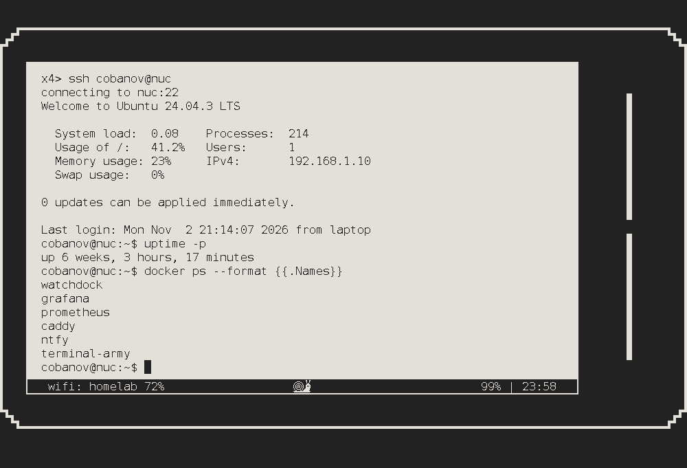
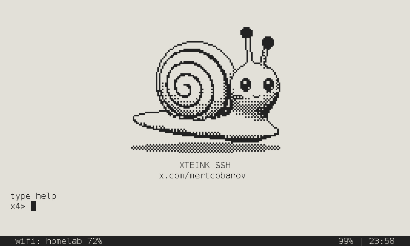
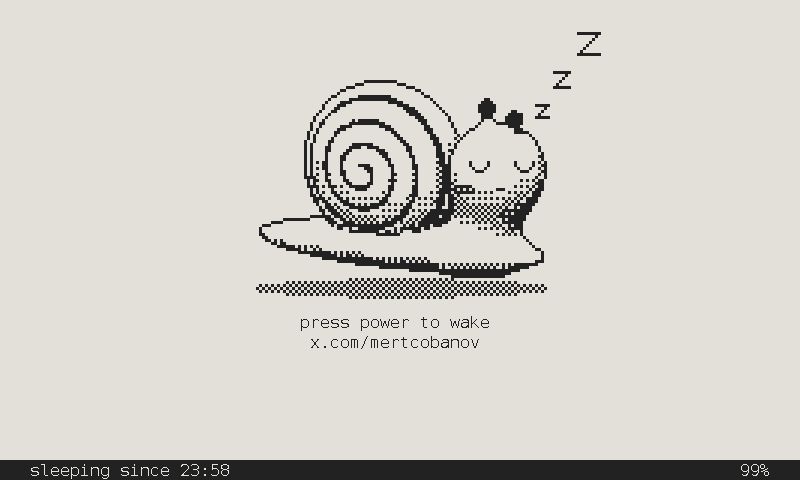

# x4ssh

SSH on a pocket e-ink reader. x4ssh turns the Xteink X4 into a terminal: pair a Bluetooth keyboard and log in to your
machines. It is part of the [cyberdeck](https://github.com/cobanov/cyberdeck).

Download it at **[x4ssh.cobanov.dev](https://x4ssh.cobanov.dev)**.

<p align="center">
  
</p>

The X4 is held sideways. Its 800x480 panel shows 76 columns by 22 rows, with a status bar along the bottom:
`wifi: <ssid> <signal>%` on the left, `<battery>% | <clock>` on the right.

SSH is a secure shell and e-ink takes its time, so the mascot is a snail. It sweeps a dish while Wi-Fi connects, moves
to the status bar when text reaches it, and sleeps on the panel with the power off.

<p>
  
  
</p>

## What you need

- An Xteink X4 running CrossPoint. The X4 Pro and Classic are untested.
- A Bluetooth LE keyboard. The X4's ESP32-C3 has no Classic Bluetooth, so keyboards like Apple's Magic Keyboard can't
  connect. Tested: M7, which pairs and reconnects on boot.
- An SD card.

## Install

1. Copy `firmware.bin` from the [site](https://x4ssh.cobanov.dev) or a [release](https://github.com/cobanov/x4ssh/releases) to the SD card's root
2. Put the card in the X4
3. Open Settings → System → SD Card Firmware Update

To go back, type `crosspoint` at the prompt. The SD update has not been tried on a device yet. If it fails,
[flash over USB](#build-and-flash).

## Two firmwares

`crosspoint-x4ssh.bin`, on every [release](https://github.com/cobanov/x4ssh/releases), is CrossPoint 1.6.5 with
`tools/crosspoint-dualboot.patch` on it. With it, Power wakes CrossPoint and Down + Power wakes x4ssh, no keyboard
needed. Without it `crosspoint` is one way: the way back is the SD update or USB.

Install it first, the same way as `firmware.bin`, then install `firmware.bin` and type `crosspoint` once. This has only
been tried on a device over USB (`esptool write-flash 0x650000 crosspoint-x4ssh.bin`, with x4ssh in the first slot).
CrossPoint's own updates write the slot x4ssh sits in.

To build it yourself:

```sh
git clone --branch 1.6.5 --recurse-submodules https://github.com/crosspoint-reader/crosspoint-reader
cd crosspoint-reader && git apply ../x4ssh/tools/crosspoint-dualboot.patch
../x4ssh/tools/pio run -e gh_release
```

Both projects rebuild the same PlatformIO core, so never build them at once.

## Use

It boots into a local prompt:

```
x4> wifi                 ssid + password, kept in NVS
x4> pair                 pair a BLE keyboard (or Confirm on an empty prompt, before the first one)
x4> key                  this device's ed25519 public key, for authorized_keys
x4> ssh me@nuc           user@host[:port]
x4> ssh                  the last host again
x4> forget <host>        drop a saved host key
x4> stat                 keyboard, wifi, heap, battery
x4> tz UTC-3             the clock's zone as a POSIX TZ string, kept in NVS (UTC until set)
x4> crosspoint           boot the firmware x4ssh was installed from
x4> clear                clear the screen
x4> sleep                turn off; the power button wakes it
x4> help                 all of this
```

The buttons work without a keyboard:

| Button | |
|---|---|
| Arrows | Arrow keys |
| Confirm | Enter |
| Back | Esc |
| Confirm + Back | Redraw the screen |
| Back, held | A page of every button, key and command, with the wifi and keyboard state. Any key closes it |
| Power, held | Sleep |
| Power | Wake. With [both firmwares](#two-firmwares), wake CrossPoint |
| Down + Power | With both firmwares, wake x4ssh |

Everything drawn is mirrored to USB serial, and USB serial is also a keyboard: `pio device monitor --eol CR` drives the
device from a Mac.

The key is made on the device on first boot and never leaves it. Password login is the fallback. Host keys are trusted
on first use and saved in `/littlefs/known_hosts`, and a changed key is always refused. The key and the Wi-Fi password
sit unencrypted in flash, so whoever holds the device can read them over USB.

The terminal draws ASCII, Latin-1, box drawing (light, heavy, double), DEC line drawing and block elements. There is no
Turkish ş ğ ı İ yet. Arrow keys follow DECCKM, and cursor-position and device-attribute queries are answered over SSH.

## Known issues

- The cursor moves on the panel only with the next text or clock change, so arrow keys at a shell prompt or in vim look
  dead.
- Confirm + Back also sends Enter, so a command typed on the line runs.
- Current ncurses repeats a character with `ESC[<n>b`, which x4ssh doesn't handle: lines come out one character long.
- Bold, underline and text colors aren't drawn.
- Emoji and other wide characters push the columns after them one to the left.
- It only sleeps when told to, so it can run down in a bag.
- On a machine with no PlatformIO yet, the first `tools/pio run` stops with
  `No module named 'SCons.Tool.FortranCommon'`. Run it again. If your newest Python is 3.15, use
  `UV_PYTHON=3.14 tools/pio run`.

## Build and flash

```sh
git submodule update --init --recursive
tools/flash.sh            # first run saves the whole flash to backup/ (CrossPoint + its settings), then flashes
tools/flash.sh --restore  # back to CrossPoint, exactly as it was
```

The backup goes through the ROM loader: esptool's stub dies on this X4's flash at `0x13a000` every time. `backup/` holds
CrossPoint's NVS, saved Wi-Fi passwords included, so keep it local.

Build with `tools/pio run`, not plain `pio`. The firmware rebuilds the Arduino core with CrossPoint's heap settings (BLE
controller in flash, trimmed NimBLE pools), which needs PlatformIO Core 6.1.19; Core 6.2's SCons breaks pioarduino's core
builder. The first build compiles ESP-IDF and takes a few minutes, and later builds are cached. With Wi-Fi and the
keyboard up, about 55 KB of heap stays free (12 KB on the prebuilt core).

## Test

```sh
test/run.sh     # key mapping, the VT parser, drawn glyphs and the mascot through the real renderer, on the host
tools/pio run   # firmware
```

## Site and design

`site/` is x4ssh.cobanov.dev: `public/` the page, `hero/` the live panel (Stageshow kit), `film.sh` its frames through the
real renderer, `tiles.py` the dither and the snail from the kit. `cd site && npx wrangler deploy` builds the hero, copies
the last `firmware.bin` into `/dl/` and ships it. Rerun `film.sh` when anything drawn on the panel changes.

The snail, logos, tokens and rules are in [`design/`](design/README.md). `design/mascot/build.py` rebuilds them and
`include/mascot.h`.

## Built on

[penk/X4Term](https://github.com/penk/X4Term)'s VT100 engine and renderer, [LibSSH-ESP32](https://github.com/ewpa/LibSSH-ESP32)
for SSH and [freeink-sdk](https://github.com/Free-Ink/freeink-sdk)'s `BleKeyboardHost`, the BLE stack CrossPoint uses, for
the keyboard. Licenses are in [THIRD_PARTY.md](THIRD_PARTY.md).

Xteink and X4 belong to their owners. x4ssh is not affiliated with Xteink.
