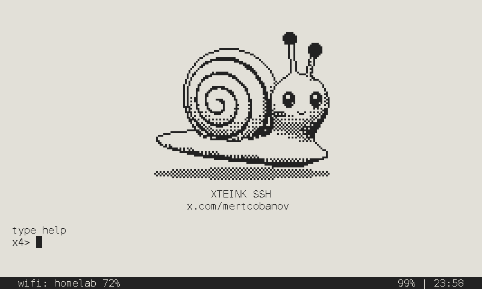
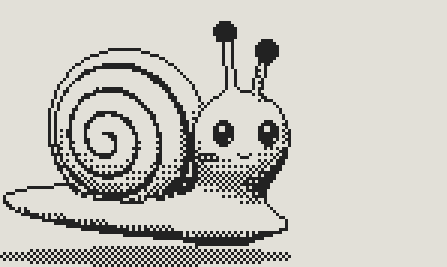
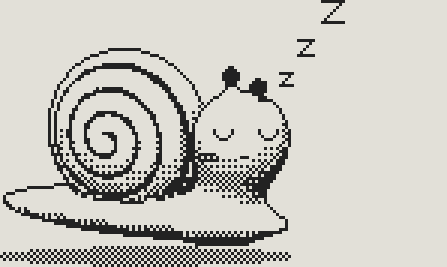
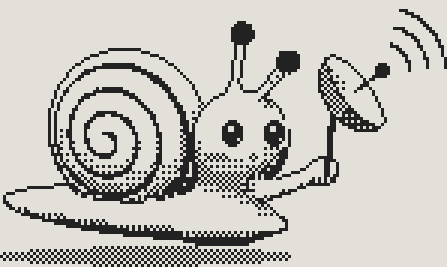

# x4ssh design kit

Snail, logos, tokens and rules. `assets/` holds the files; `mascot/` the sources.

```
uvx --with pillow --with numpy python design/mascot/build.py   # assets/ and include/mascot.h
```

## The idea

x4ssh is a snail. It carries a shell, as SSH is a Secure Shell, and it moves at the speed of e-ink. Everything here is drawn for a 1-bit screen first: two inks, no grey, every pixel placed.



## Content fundamentals

- Write the name `x4ssh`, lowercase, always, also at the start of a sentence.
- Device copy is lowercase, short and tells you what to do next: `press power to wake`, `type help`, `no wifi yet, run: wifi`, `sleeping since 23:58`.
- State facts in the terminal's own words: `wifi: homelab 72%`, `99% | 23:58`. No exclamation marks, no emoji, no "please".
- The snail never speaks. It shows what the device is doing; the text says it.

## Visual foundations

**Colour.** Use `ink` on `paper`. They are the panel's two states, 12:1 apart, and the brand has no other colours. Reverse them only for the status bar and for icon tiles. On the device pixels are pure on or off; the hex values show how the panel looks in a preview. The website is the one exception: it sits on `ink`, the two reversed, with the status bar as a `paper` band.

**Tone.** Make tone with dither, never with grey: `dither-25`, `dither-50` and `dither-75` are 2x2 patterns. Use the `tone-*` colours only where a flat fill is unavoidable, such as the web.

**Scale.** Scale art by whole numbers only, with nearest-neighbour. One art pixel is `art-px` device pixels on the X4. Never resample, smooth or anti-alias.

**Drawing.** A form gets a 1-pixel outline taken from its silhouette and creases, then light from the front and above in banded dither. Eyes, mouth and small props are placed by hand. The only shadow is the dithered contact shadow under the foot. There are no radii: `radius-none` everywhere.

**Layout.** Everything sits on the terminal grid: `cell-w` by `cell-h` cells, 76 columns by 22 rows, inside `margin-x` and `margin-top`. The status bar is the reversed band across the bottom, `status-h` tall, `status-gap` under the last row.

**Motion.** E-ink has no tweening. Step between whole frames, at least a second apart, and stop on your own: the dish sweep ends after 40 seconds.

## The snail

| Pose | Files | Shown |
| --- | --- | --- |
| Awake | `awake` | Boot, once wifi is up or when none is saved |
| Asleep | `asleep` | The sleep screen, which stays on the panel with the power off |
| Scanning | `scan-1`, `scan-2`, `scan-3` | While wifi connects: a dish in hand, the three frames add one wave each |





- All poses share one frame, so the snail stays put when the pose changes.
- It faces right, toward what comes next. Do not mirror it.
- Once text scrolls up into its rows, the large snail leaves and `mark-24` takes over in the status bar, mid-bar, so it stays with you for the whole session.
- Give a new pose a prop and a job, as the dish does. A pose that only stands there adds nothing.

## Logo

- Use `horizontal` wherever there is width, `stacked` in square spaces, `wordmark` where the snail is already on the page.
- The letters of the wordmark are drawn. Never type the name in a font in its place.
- Keep clear space of one wordmark letter height on every side.
- Minimum sizes at 1x: `horizontal` 117 px wide, `stacked` 86 px wide, `mark-24` 25 px, `mark-16` 16 px, a dithered pose 149 px.
- Use the `-reversed` files on `ink`.

Do not: colour it, tilt it, outline it, add a shadow, dither the marks, or scale by anything but a whole number.

## Iconography

The dithered poses fall apart below 1x, so small sizes are separate drawings with a solid body and a line shell.

- `mark-24` (25x18): the status bar, and anything from 24 px to 64 px.
- `mark-16` (16x14): favicons and anything under 24 px.
- Web icons are exact integer scales of these two; use the files as they are.

## Type

- Set everything on the device in `terminal`: DejaVu Sans Mono at 16 pt, rasterised to the 10x20 bitmap font. `status` is the same face, reversed.
- On the web use the `mono` family.
- Use `display` for large headings only. The name itself is the wordmark.
